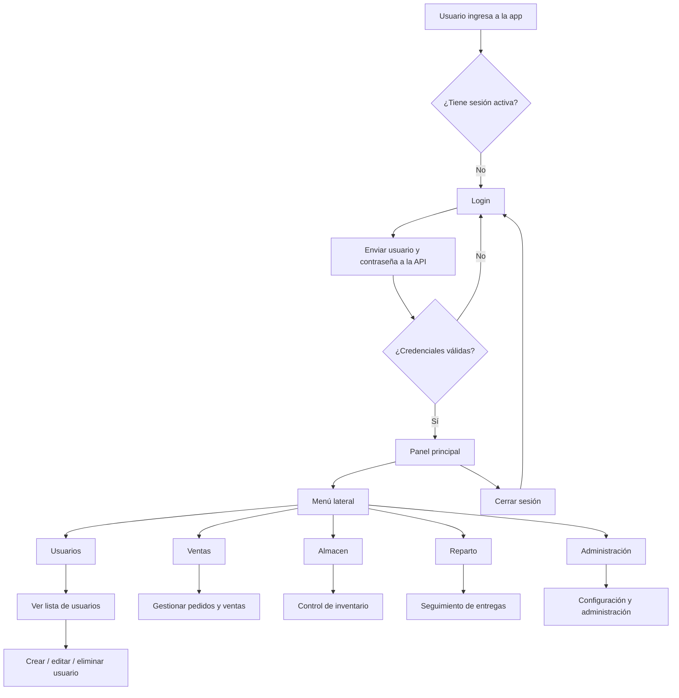
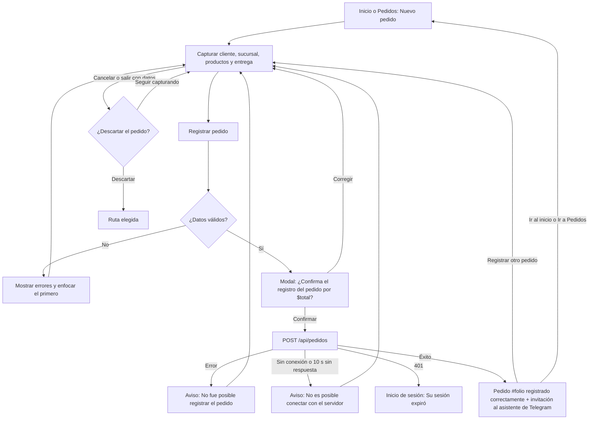
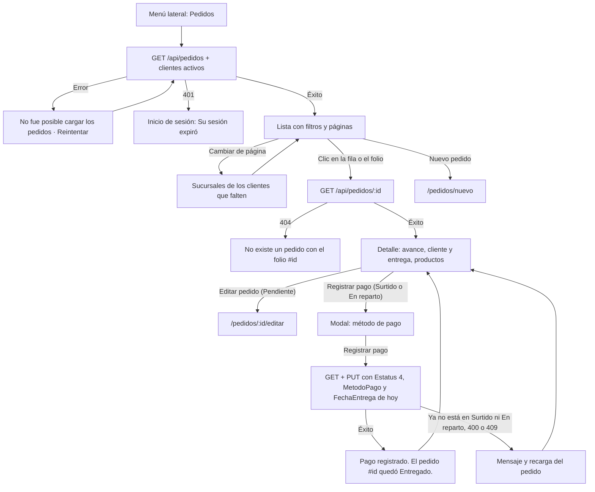
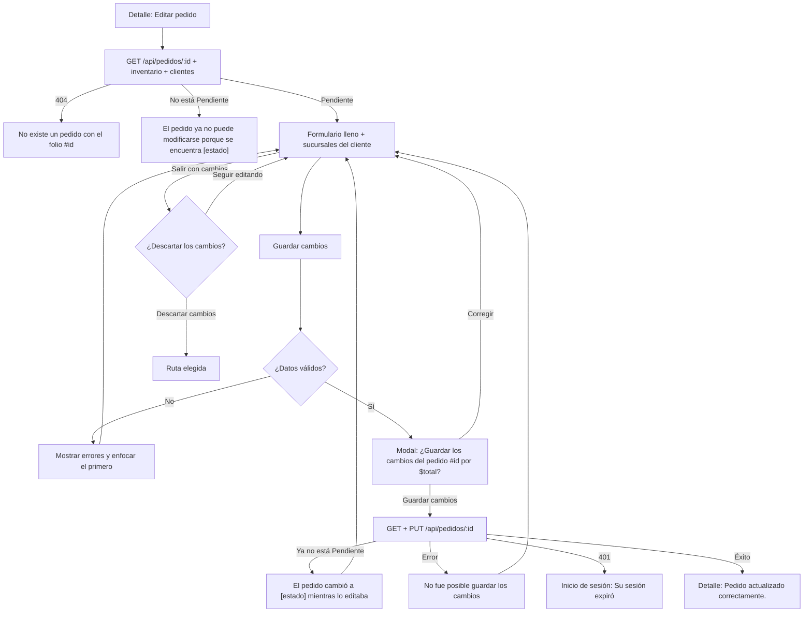

# Flujo de la aplicación

## Vista general

La aplicación inicia en una pantalla de autenticación y, una vez validado el acceso, dirige al usuario al panel principal del sistema. Desde allí se puede navegar entre los distintos módulos funcionales del negocio.

## Flujo actual implementado

La base actual del sistema tiene estas rutas principales:

- `/` → redirige a `/inicio-sesion`
- `/inicio-sesion` → pantalla de acceso
- `/panel` → panel principal de la app
- `/usuarios` → vista de administración de usuarios
- `/pedidos` → lista de todos los pedidos (desde "Pedidos" en el menú lateral)
- `/pedidos/nuevo` → captura y registro de un pedido (desde el botón "Nuevo Pedido" del panel o de la lista de pedidos)
- `/pedidos/:id` → detalle de un pedido (desde su fila o su folio en la lista)
- `/pedidos/:id/editar` → edición de un pedido Pendiente (desde "Editar pedido" en el detalle)

## Lógica funcional por pantalla

### 1. Inicio de sesión

- `InicioSesionVista.vue` envía `usuario` y `contrasena` a `POST /api/auth/login`.
- La API consulta SQL Server y, si las credenciales son válidas, devuelve un `accessToken`.
- La interfaz guarda el token y dirige al usuario al panel; si hay un error, muestra el mensaje recibido.

### 2. Panel principal

- Después del acceso, el usuario llega al panel principal.
- Este módulo central organiza la navegación entre áreas.
- El diseño principal se construye con un layout común compuesto por encabezado, navegación lateral y contenido.

### 3. Usuarios

- La vista de usuarios muestra una tabla con datos de ejemplo.
- Se presentan campos como tipo, nombre, usuario, teléfono, estado y acciones de edición o eliminación.
- Actualmente representa una maqueta funcional de la gestión administrativa.

### 4. Nuevo pedido (módulo de ventas)

- `NuevoPedidoVista.vue` se divide en tres pasos y un resumen lateral que se queda fijo al desplazar. En pantallas de menos de 900 px, el resumen va debajo del formulario.
- Se abre desde Inicio o desde Pedidos y regresa a esa pantalla: la flecha de regresar, Cancelar, Descartar y el botón que aparece después de registrar ("Ir al inicio" o "Ir a Pedidos"). La ruta de navegación y el menú lateral también marcan el origen. Si se entra directo por la URL, regresa a Pedidos.
- **Cliente**:
  - Al hacer clic en el buscador (o con la flecha abajo) se despliega la lista de todos los clientes activos, por nombre. Al escribir, la lista se reduce al instante desde la primera letra, sin importar acentos ni mayúsculas: primero los que empiezan con lo escrito y después los que lo contienen. La lista sale de `GET /api/clientes/activos`, se pide una vez y se filtra en el navegador. Si la API agrega el teléfono, también se busca por él.
  - Enter elige la opción resaltada, o el cliente si solo queda uno.
  - La lista se recorre con flechas, Enter y Escape.
  - Al elegir el cliente se cargan sus sucursales activas. Si tiene una, se selecciona sola; si tiene varias, se elige en la lista; si no tiene, se avisa y solo se puede registrar con recolección. La sucursal es obligatoria a domicilio; en recolección no se pide.
  - Los clientes nuevos no se dan de alta aquí.
- **Productos**:
  - Salen del inventario real.
  - Cada renglón lleva cantidad en kg con − / + o captura directa.
  - Si la cantidad supera lo disponible, el renglón se marca al instante.
- **Entrega**:
  - Modalidad: Entrega a domicilio o Recolección en congeladora.
  - No se captura fecha de entrega: se llena al registrar el pago (en el detalle del pedido o en el sistema interno).
  - A domicilio se entrega siempre en la dirección registrada de la sucursal elegida: se muestra de solo lectura con un enlace "Ver en Maps" y no se puede escribir otra. Si la sucursal no tiene dirección, no se puede registrar a domicilio hasta que se capture en las sucursales del cliente. No se capturan referencias.
  - Recolección no pide sucursal: muestra el punto de recolección (Proceso Conservación y Comercio (Global Foods)) con un enlace "Ver en Maps".
  - No se elige método de pago: todo pedido nuevo se crea como Pendiente y cambia a Efectivo o Crédito o transferencia al registrar el pago, en el detalle del pedido o en el sistema interno.
  - Las observaciones son opcionales, de máximo 250 caracteres.
- Al registrar se valida todo y el foco va al primer error. Si todo es válido, se confirma el resumen antes de enviar.
- El registro usa `POST /api/pedidos` y manda siempre `MetodoPago` en 0 (pendiente) y en `Fecha` el día en que se crea. A domicilio, `IdSucursal` es la sucursal elegida; en recolección va en 0. La modalidad viaja al inicio de `Observaciones` (`A domicilio · notas` o `Recolección en congeladora · notas`), porque la API no tiene campo para ella. Los pedidos anteriores y los de la app móvil pueden traer además `Ref: …`: se muestra como parte de las observaciones y se conserva al editar. El folio es `#` y el `Id` del pedido creado.
- Al registrarse, el modal muestra el folio y una invitación a comunicarse con el asistente de Telegram para información sobre el pedido (enlace "Abrir en Telegram" a `https://t.me/GlobalFoodsMexicobot`, en otra pestaña; la dirección está en `asistente.ts`).

### 5. Pedidos (módulo de ventas)

- **Lista** (`PedidosVista.vue`): todos los pedidos de `GET /api/pedidos`, del más reciente al más antiguo, en páginas de 10.
  - Un clic en cualquier parte de la fila abre el detalle; con Ctrl/Cmd + clic, en otra pestaña. Si se está seleccionando texto de la fila, no navega. El folio sigue siendo un enlace, para llegar con el teclado o abrirlo en otra pestaña con clic central.
  - Filtros por estado (Todos, Pendiente, Surtido, En reparto, Entregado, Cancelado), cada uno con su conteo según la búsqueda y las fechas.
  - Búsqueda por folio o nombre del cliente, sin importar acentos ni mayúsculas, y rango Desde / Hasta sobre la fecha de registro.
  - El buscador funciona como el de Nuevo pedido: al hacer clic se despliegan los clientes que tienen pedidos, con cuántos tiene cada uno, y al escribir la lista se reduce. Elegir un cliente deja solo sus pedidos; volver a escribir regresa a buscar por folio o nombre.
  - La columna Entrega es la fecha de entrega que regresa la API (`FechaEntrega`, se llena al registrar el pago); mientras no la tenga, "—".
  - La modalidad sale de leer `Observaciones`, que también entiende los pedidos anteriores y los de la app móvil (traen `Entrega dd/mm/aaaa` después de la modalidad; esa fecha se ignora). Si el texto no empieza con una modalidad, se muestra "—".
  - Un pedido con `IdSucursal` 0 es de recolección aunque `Observaciones` no lo diga: en lugar de la sucursal se ve "Recolección en congeladora".
  - La columna Método de pago muestra Pendiente, Efectivo o Crédito o transferencia, igual que el detalle ("—" si la API no lo trae).
- **Detalle** (`DetallePedidoVista.vue`): barra de avance de los cuatro estados, cliente y entrega, y productos con su total. La fecha de entrega sale del mismo campo de la API que la lista. A domicilio, la dirección de entrega lleva su enlace "Ver en Maps"; en recolección se muestra el punto de recolección con su enlace "Ver en Maps"; si además es `IdSucursal` 0, la sucursal dice "Recolección en congeladora". Si el folio no existe, se avisa con un enlace de regreso a la lista.
- Acciones del detalle (por ahora solo para el administrador): "Editar pedido" en Pendiente, "Registrar pago" en Surtido o En reparto y "Cancelar pedido" mientras no se haya entregado. Las tres consultan antes el pedido con `GET /api/pedidos/:id` y, si su estado todavía lo permite, lo vuelven a mandar completo con `PUT /api/pedidos/:id` (el método de pago y la fecha de entrega, si la API los regresa, se reenvían con el mismo nombre de campo, salvo lo que cambia la acción). Si el estado ya no lo permite, no se manda nada y se avisa por qué.
- Cancelar pedido: Creado, Surtido o En reparto, igual que en la app móvil. Solo pide confirmación y avisa si almacén ya surtió o si ya salió a reparto. Manda el mismo pedido con Estatus 5. El pedido no se borra: queda Cancelado, con su propia píldora en los filtros y un aviso en el detalle en lugar de la barra de avance. Todavía no se pide el motivo (RF-PED-03), porque la API no tiene dónde guardarlo.
- Registrar pago: en Surtido o En reparto. La ventana muestra el total y pide el método, Efectivo o Transferencia (sin elegir, "Seleccione el método de pago."), y avisa que el pedido quedará Entregado con la fecha de entrega de hoy. Manda el mismo pedido con Estatus 4, el método elegido (1 o 2) y `FechaEntrega` de hoy (`aaaammdd`). Al terminar: "Pago registrado. El pedido #id quedó Entregado." y se recarga el pedido. En la lista y el detalle el 2 se sigue viendo como "Crédito o transferencia", porque el sistema interno lo usa también para crédito.
- Errores de cancelar y registrar pago: sin conexión, se avisa y la ventana sigue abierta; con 400 o 409 (p. ej. el pedido ya cambió de estado), se cierra, se muestra el mensaje y se recarga el pedido; con otro error, se avisa que no fue posible.
- Surtido no se cambia en la web: almacén lo marca en el sistema interno. El pago se puede registrar en la web o en el sistema interno; ahí, al cobrar, el pedido pasa a Entregado con su método de pago y su fecha de entrega. La lista y el detalle se actualizan solos cada minuto, y al regresar a la pestaña, para reflejarlo (en el detalle, no mientras está abierta la ventana de cancelar o de pago). Ambos muestran el método de pago (Pendiente mientras no se cobra).
- Todavía no hay historial de cambios, porque la API no lo guarda.
- Si la API responde 401, se cierra la sesión y se pasa a inicio de sesión con "Su sesión expiró. Inicie sesión nuevamente."

### 6. Editar pedido (módulo de ventas)

- `EditarPedidoVista.vue` usa las mismas secciones, resumen y modales que Nuevo pedido, y la misma lógica de formulario (`usarFormularioPedido.ts`); lo propio de la edición está en `usarEditarPedido.ts`. Solo se edita un pedido Pendiente (RF-PED-02).
- Al abrir, carga el pedido y llena el formulario: cliente fijo (no se puede cambiar), sucursal, modalidad, observaciones y productos con su cantidad. La sucursal se elige cuando llegan las sucursales activas del cliente.
- Se pueden cambiar productos y cantidades, modalidad, sucursal (a domicilio, su dirección es la de entrega) y observaciones, con las mismas validaciones y mensajes que Nuevo pedido.
- Las líneas que ya traía el pedido conservan su precio por kg; las nuevas toman el del inventario. El límite de una línea que ya venía es lo disponible o lo que ya tenía, lo que sea mayor; si su producto ya no está en el inventario, no se puede aumentar.
- Si el pedido ya no está Pendiente, en lugar del formulario se avisa "El pedido ya no puede modificarse porque se encuentra [estado]." con un enlace al detalle.
- Guardar confirma "¿Guardar los cambios del pedido #id por $total?", vuelve a consultar el pedido y, si sigue Pendiente, lo manda con `PUT /api/pedidos/:id` con la sucursal, los totales, las observaciones y las líneas nuevas; el cliente, la fecha, el estatus, el método de pago y la fecha de entrega van tal como llegaron.

## Relación con los módulos

El flujo general del sistema está pensado para que cada módulo tenga una responsabilidad clara:

- Autenticación: acceso y gestión del token
- Principal: panel general
- Admin: usuarios y configuración
- Ventas: operación comercial
- Almacen: inventario y stock
- Reparto: entregas y logística

## Observación de desarrollo

El inicio de sesión y la consulta de inventario ya están conectados con la API. En ventas, Nuevo pedido ya usa el inventario, los clientes activos, sus sucursales y el registro de pedidos reales, y la pestaña Pedidos consulta la lista y el detalle, edita los pedidos pendientes, registra el pago y cancela. Las pantallas de administración y reparto todavía requieren integrar sus operaciones con el backend.
